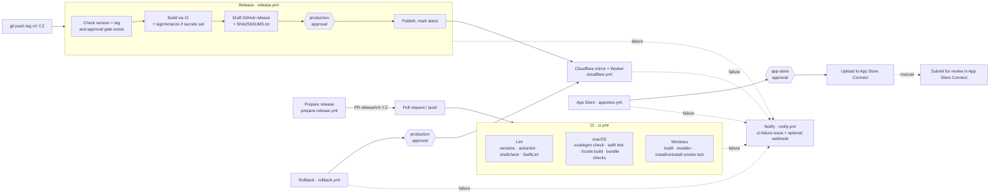

# FileFlipper CI/CD

How FileFlipper is built, tested, versioned, released, and rolled back. Everything runs on GitHub
Actions. Nothing reaches users (the GitHub release, the website download buttons, dl.fileflipper.app,
or the Mac App Store) until a maintainer approves it.

## Overview



| Workflow | File | Runs on | Does |
|---|---|---|---|
| **CI** | `ci.yml` | every PR; pushes to `main`, `release/**`, `ci/**`; by hand; called by Release | Lint, regression tests, Mac and Windows builds, artifacts `mac` and `windows` |
| **Prepare release** | `prepare-release.yml` | by hand, from `main` | Bumps the version and build number, opens a `release/vX.Y.Z` PR with draft notes |
| **Release** | `release.yml` | tag `v*`; by hand (dry run, or with a tag) | Builds through CI, stages a **draft** release, publishes after `production` approval, mirrors to Cloudflare |
| **App Store** | `appstore.yml` | by hand, with a tag | Archives and exports the signed `.pkg`, uploads it after `app-store` approval |
| **Rollback** | `rollback.yml` | by hand | Points "latest" back at a good release after `production` approval, re-mirrors Cloudflare |
| **Cloudflare** | `cloudflare.yml` | website/Worker changes on `main`; called by Release and Rollback | Unchanged: mirrors the latest release to R2, deploys the Worker |
| **Notify** | `notify.yml` | when any of the above finishes | Opens or updates a `ci-failure` issue on failure and closes it on the next success |

## CI (`ci.yml`)

**Lint** (Ubuntu, about 1 minute)
- `scripts/version.sh check`: the version in `project.yml` matches the Xcode project, the Windows
  `.csproj`, the Inno Setup script, and the fallback in `build-app.sh`.
- `actionlint` on all workflows, `shellcheck` on `scripts/`.
- `SwiftLint --strict` with `.swiftlint.yml`. Only rules the current code already passes are on, so
  new warnings fail the build but the existing style is unchanged.

**macOS** (`macos-15`)
- XcodeGen 2.46.0 regenerates `FileFlipper.xcodeproj` and the job fails if it differs from the
  committed project, which catches a change made to only one of `project.yml` and the project.
- `swift test`: the regression suite in `Tests/FileFlipperTests`. It covers output naming (never
  overwrite), file-type detection, which formats and tools appear for each type, PNG→JPG, images→PDF,
  CSV→Markdown, Markdown escaping and tables, localization placeholders, `Info.plist`, and the sandbox
  entitlement.
- `scripts/build-app.sh`: the same sandboxed Xcode build as before, plus `swift build -c release`.
- `scripts/ci/verify-mac-app.sh`: checks the bundle ID, version and build number against `project.yml`,
  menu-bar mode, the Chinese localization and privacy manifest in the bundle, a valid signature with the
  sandbox entitlement, and a universal binary (arm64 and x86_64).
- On failure, `xcodebuild.log` and the test log are uploaded as `mac-logs`.

**Windows** (`windows-latest`)
- `windows/build.ps1` builds the self-contained `.exe`, then `-Package -NoBuild` makes the zip and the
  Inno Setup installer. The two steps are separate so the `.exe` can be signed before it is packaged.
- Smoke test: checks the `.exe` version, size, and outputs, then does a silent install to
  `%LOCALAPPDATA%\Programs\FileFlipper`, checks the installed file, and silently uninstalls.
- The Windows app has no unit tests yet. The Windows regression coverage is this build plus the
  install/uninstall smoke test.

## Versioning

`project.yml` is the source of truth. `scripts/version.sh` keeps every other copy in step:

```bash
./scripts/version.sh show            # 1.7.0 (build 13)
./scripts/version.sh check v1.7.0    # fails if any file or the tag disagrees
./scripts/version.sh bump minor      # 1.8.0, build 14 (patch | minor | major | 1.8.0)
./scripts/version.sh sync            # copy project.yml's version everywhere, no build bump
```

`bump` always raises `CURRENT_PROJECT_VERSION`, because App Store Connect rejects a build number it
has already seen. It edits the version lines in the Xcode project directly instead of regenerating it,
so your local signing team setting is left alone.

## Releasing

1. **Actions › Prepare release › Run workflow** (from `main`) with `patch`, `minor`, `major`, or an exact
   version. It pushes `release/vX.Y.Z` with the bump, opens a PR with draft notes, and starts CI on it.
   If Actions is not allowed to create PRs, the run summary has a link to open the PR yourself.
   Locally, `./scripts/version.sh bump minor` followed by a PR does the same thing.
2. Merge the PR once CI is green.
3. Tag the release: `git tag v1.8.0 && git push origin v1.8.0`. Or run **Release** with `tag: v1.8.0`,
   which creates the tag at the head of the branch you run it from.
4. Release checks that the tag matches `project.yml` and that the `production` gate exists, then builds,
   tests, and signs. It stages a **draft** release with `FileFlipper.zip`,
   `FileFlipper-Windows-Setup.exe`, `FileFlipper-Windows.zip`, and `SHA256SUMS.txt`. Users can't see
   drafts, and `releases/latest` keeps pointing at the previous version.
5. Review the draft, then **approve the `production` deployment** on the run. Publishing marks the
   release as latest, and the Cloudflare job mirrors it to dl.fileflipper.app.

**Dry run:** run **Release** with no tag on any branch. It builds, tests, and packages the same way,
and the artifacts are on the run page. Nothing is tagged or released.

## Mac App Store

The App Store build is the same sandboxed app, signed for distribution.

1. Release the version first (above), so the tag exists.
2. **Actions › App Store › Run workflow** with `ref: v1.8.0`. It runs the tests, archives with Xcode's
   cloud-managed signing (App Store Connect API key, no certificates stored in the repo), exports
   `FileFlipper.pkg`, and checks its signature. The `.pkg` is kept as the `appstore-pkg` artifact.
3. **Approve the `app-store` deployment** to upload the `.pkg` to App Store Connect.
4. **Manual, in App Store Connect:** wait for Apple to process the build (5–30 minutes), add it to the
   version, fill in "What's New", and click **Submit for Review**. CI never submits for review or
   releases on the App Store. `APP_STORE.md` covers the listing itself.

Xcode's Organizer (described in `APP_STORE.md`) still works as a manual fallback.

## Signing and secrets

No certificate, key, or password is stored in the repository. All of them are encrypted GitHub
secrets, which are only available to workflows in this repo (not to pull requests from forks). CI
decodes them into `$RUNNER_TEMP`, puts the certificate in a throwaway keychain with a random password,
and `scripts/ci/cleanup-signing.sh` deletes all of it at the end of the job, even if the job fails.
Signing only happens in Release and App Store runs, never for pull requests.

Every secret is **optional**. Without the Developer ID or Windows secrets, releases come out as they
do today (ad-hoc signed Mac zip, unsigned Windows build). Without the App Store Connect key, only the
App Store workflow is unavailable.

| Name | Kind | Used by | What |
|---|---|---|---|
| `APP_STORE_CONNECT_API_KEY_P8` | secret | App Store, Release (notarization) | `base64 -i AuthKey_XXXX.p8`. App Store Connect › Users and Access › Integrations › Keys. **Admin** role is needed for cloud signing. |
| `APP_STORE_CONNECT_KEY_ID` | secret | same | The key's ID |
| `APP_STORE_CONNECT_ISSUER_ID` | secret | same | The issuer ID shown above the keys list |
| `APPLE_TEAM_ID` | variable | App Store | Your 10-character Team ID (Membership details) |
| `MACOS_DEVELOPER_ID_P12` | secret | Release | `base64 -i DeveloperID.p12`. Export **Developer ID Application** with its private key from Keychain Access. |
| `MACOS_DEVELOPER_ID_P12_PASSWORD` | secret | Release | The `.p12` export password |
| `WINDOWS_SIGNING_PFX` / `WINDOWS_SIGNING_PFX_PASSWORD` | secrets | Release | Authenticode code-signing certificate (base64 `.pfx`) and its password |
| `NOTIFY_WEBHOOK_URL` | secret | Notify | Slack or Discord incoming-webhook URL |
| `CLOUDFLARE_API_TOKEN` / `CLOUDFLARE_ACCOUNT_ID` | secrets | Cloudflare | Already set (see `cloudflare/README.md`) |

Set them with the GitHub CLI so they never land in your shell history:

```bash
base64 -i AuthKey_ABC123.p8 | gh secret set APP_STORE_CONNECT_API_KEY_P8
```

```bash
gh secret set APP_STORE_CONNECT_KEY_ID
```

```bash
gh variable set APPLE_TEAM_ID
```

Other hardening:
- Every workflow has `contents: read` by default. Only the jobs that tag or publish get `contents: write`.
- Third-party actions are pinned to commit SHAs, and Dependabot (`.github/dependabot.yml`) opens a
  monthly PR to update them.
- Tool versions are pinned too: actionlint 1.7.12, SwiftLint 0.65.1, XcodeGen 2.46.0.

## One-time setup (approval gates)

The manual gates are GitHub **environments** with a required reviewer. GitHub creates a missing
environment automatically, with no protection, the first time a job uses it. So Release, App Store,
and Rollback check first and refuse to run until the gate exists
(`scripts/ci/require-approval-gate.sh`).

In **Settings › Environments**, create these two environments. For each one, tick **Required
reviewers** and add yourself:

- `production`: publishing a GitHub release, and rollback. Under *Deployment branches and tags*,
  allow `main` and tags `v*`.
- `app-store`: uploading to App Store Connect. Allow tags `v*`.

To let Prepare release open the PR itself, tick **Settings › Actions › General › Allow GitHub Actions
to create and approve pull requests**. This is optional; otherwise you open the PR from the link the
run prints.

## Failure notifications

- GitHub already emails whoever started a run when it fails (Settings › Notifications › Actions).
- **Notify** (`notify.yml`) runs on failures of CI on `main`, releases, Cloudflare, App Store,
  Rollback, and Prepare release. It opens one issue per workflow titled `CI failure: <workflow>` with
  the `ci-failure` label and a link to the run, and adds comments on repeat failures. Repository
  watchers get it by email and on mobile. The issue closes itself when that workflow next passes.
- If `NOTIFY_WEBHOOK_URL` is set, it also posts to Slack or Discord.
- Pull request failures show on the PR itself and don't open issues.
- `workflow_run` only fires for workflow files on the default branch, so Notify starts working once it
  is merged to `main`.

## Rollback

**GitHub release, website, and dl.fileflipper.app.** Run **Actions › Rollback** with
`good_tag: v1.7.0` (and optionally `bad_tag: v1.8.0`), then approve `production`. It:

1. checks that the good release is published and has all three files,
2. turns the bad release into a pre-release (nothing is deleted; run Rollback again with that tag to restore it),
3. marks the good release latest, so `releases/latest/download/...` and the website buttons serve it,
4. re-runs the Cloudflare mirror, so dl.fileflipper.app and `latest.json` serve the good version.

Without Actions, the manual equivalent is
`gh release edit v1.8.0 --prerelease --latest=false && gh release edit v1.7.0 --latest`, then
**Actions › Cloudflare › Run workflow**.

**A draft that was never approved:** nothing to roll back. Delete the draft and the tag
(`gh release delete v1.8.0 --cleanup-tag`) if you don't want to retry it.

**Mac App Store:** Apple doesn't let you put an older build back. Your options:
- *Before release:* in App Store Connect, remove the build from review, or keep **Manually release
  this version** selected and don't release it.
- *During a phased release:* **Pause Phased Release** (up to 30 days).
- *After release:* fix forward. `./scripts/version.sh bump patch` (this raises the build number), tag,
  release, upload, and request an **expedited review** for critical bugs. You can also temporarily
  remove the app from sale under Pricing and Availability.

Users who installed a bad Windows or Mac download can reinstall the good version from the website
once the rollback is done. FileFlipper has no auto-updater, so nothing else needs reverting.

## Running the checks locally

```bash
./scripts/version.sh check && swift test && ./scripts/build-app.sh && ./scripts/ci/verify-mac-app.sh build/FileFlipper.app
```

```bash
brew install actionlint shellcheck swiftlint && actionlint && shellcheck -S warning scripts/*.sh scripts/ci/*.sh && swiftlint lint --strict
```
